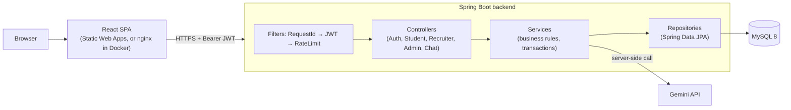
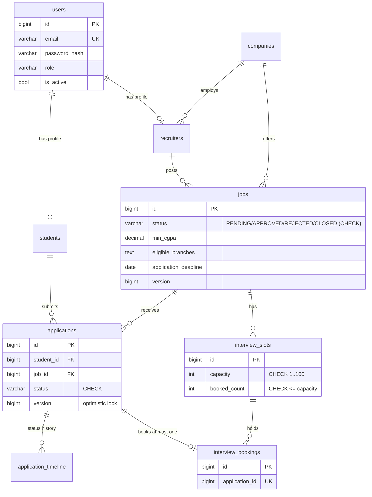
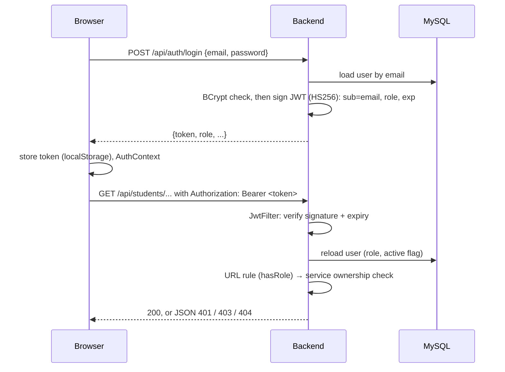
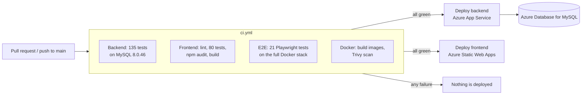

# PlacementHub

A full-stack campus placement portal for students, recruiters and the placement cell:
- **students** find jobs they are eligible for, apply, track each application and book interview slots;
- **recruiters** post jobs, review applicants, move them through a hiring pipeline and publish interview slots;
- **admins** approve job postings and follow placement activity.

It is a **Spring Boot modular monolith** with a **React** frontend and **MySQL**, deployed on Microsoft Azure. The core business rules hold under simultaneous requests, and each one is proven by tests against a real MySQL database. Every deploy is gated by CI.

**🔗 Live demo:** [agreeable-cliff-07cedfc00.1.azurestaticapps.net](https://agreeable-cliff-07cedfc00.1.azurestaticapps.net)

> The backend runs on a basic Azure App Service plan and can take 10–20 seconds to answer the first request after it has been idle.

**Contents:**
- [Features](#features)
- [Tech stack](#tech-stack)
- [Architecture](#architecture)
- [Database schema](#database-schema)
- [Authentication flow](#authentication-flow)
- [API](#api)
- [Concurrency and data consistency](#concurrency-and-data-consistency)
- [Running locally](#running-locally)
- [Testing](#testing)
- [Observability and performance](#observability-and-performance)
- [Deployment](#deployment)
- [Known limitations](#known-limitations)
- [Future improvements](#future-improvements)
- [Further documentation](#further-documentation)

---

## Features

**Student**
- Profile with college, branch, CGPA, skills and resume/LinkedIn/GitHub links.
- Job search with text, job type, location, sort and pagination, plus a **Recommended** filter that shows only jobs the student is eligible for.
- Apply in one click. The server enforces the deadline, minimum CGPA, eligible branches and one application per job, even when the button is clicked many times at once.
- Track each application with a dated status timeline (Applied → Shortlisted → Interview → Offered → Accepted / Declined / Expired, or Rejected).
- Book an interview slot once an application reaches Interview, and cancel it before the slot starts. Overlapping interviews with different companies are refused.
- **Offer Desk:** accept or decline an offer before its deadline, with a live countdown. A student holds one pending offer at a time and is placed once; after that they can't apply to more jobs. A waitlisted student sees their live position ("#2 on the waitlist").
- **Placement tiers:** once placed, a student may only take higher-tier jobs, up to the campus maximum. Accepting a higher-tier offer releases the earlier placement (that company's waitlist refills it automatically), and applications the rules now forbid are withdrawn, with their interviews cancelled.

**Recruiter**
- Personal and company profiles.
- Post, edit, delete and **close** jobs. New and edited jobs wait for admin approval.
- See applicants per job with their full profile.
- Move applications only along allowed steps. If two people change the same application at once, the second one is asked to refresh instead of silently overwriting the first.
- Publish interview slots with a capacity. A slot can never be overbooked.
- **Offer Desk:** each job has a number of openings and an offer deadline. Offers can never exceed the openings; an offer that isn't answered in time expires automatically and its opening is freed. A seat meter shows filled / pending openings.
- **Waitlist that refills itself:** put interviewed candidates on a ranked waitlist and reorder it. When an offer is declined or expires, the opening is offered to the next free candidate automatically (a candidate holding another offer is skipped, and retried once free). A "fill open openings" button does the same after raising the openings.

**Admin**
- Dashboard with live counts, pending approvals and analytics charts.
- Approve or reject job postings, choosing each job's **tier** (Regular, Dream, Super-dream); browse students and recruiters (paginated).
- **Placement rules:** whether placed students may upgrade to a higher tier, and how many offers a student may accept in total. With upgrades off: one student, one job.
- The first admin account is created from environment variables. Admins cannot sign up through the website.

**AI guide**
- A chatbot on every dashboard, backed by Google Gemini and called from the server so the API key never reaches the browser. It answers according to the user's role and is rate-limited per user.

---

## Tech stack

| Layer | Technology |
|---|---|
| Backend | Java 17, Spring Boot 4.1 (Web, Data JPA / Hibernate 7, Security, Validation, Actuator), jjwt 0.12, BCrypt, springdoc-openapi |
| Database | MySQL 8.0, schema managed by Flyway (versioned migrations) |
| Frontend | React 19, Vite, React Router, Axios, Tailwind CSS, Recharts |
| Testing | JUnit 5, Spring Boot Test, MockMvc, real-MySQL integration tests; Vitest + React Testing Library; k6 for load tests |
| Containers | Docker multi-stage images (non-root), Docker Compose, nginx (unprivileged) |
| CI/CD | GitHub Actions: tests, lint, `npm audit`, Docker build, Trivy image scan, then deploy |
| Cloud | Azure App Service (backend), Azure Static Web Apps (frontend), Azure Database for MySQL Flexible Server |

---

## Architecture

PlacementHub is a **modular monolith**: one Spring Boot application and one MySQL database, split internally by layer and by role.



- **Request path:**
  - `RequestIdFilter` gives the request a correlation id;
  - `JwtFilter` authenticates the request from the token;
  - `RateLimitFilter` refuses abusive login, register and chat traffic;
  - Spring Security checks the role for the URL;
  - the service checks **ownership** and the business rules inside one transaction.
- **Why a monolith:** a single team, a single database and a few hundred requests per second at most. All the important rules (one application per job, slot capacity) must be checked atomically, which one database does well. Microservices would turn those into distributed transactions. Interview question 10 in [docs/interview-prep.md](docs/interview-prep.md#10-why-choose-a-modular-monolith-over-microservices) explains this in more detail.

```
placementhub/
├── backend/src/main/java/com/placementhub/backend/
│   ├── config/          # Security, CORS, OpenAPI, admin bootstrap, clock/time zone
│   ├── controller/      # REST endpoints, one per role
│   ├── service/         # business rules + transactions (EligibilityPolicy, InterviewSlotService, …)
│   ├── repository/      # Spring Data JPA, entity graphs, locking / atomic queries
│   ├── entity/ enums/   # JPA entities, ApplicationStatus state machine
│   ├── dto/ mapper/     # request/response shapes and shared mappers
│   ├── security/        # JwtUtil, JwtFilter, JSON 401/403 writer
│   ├── ratelimit/       # in-memory token bucket
│   ├── observability/   # request ids, access log
│   └── exception/       # one JSON error shape for every error
├── backend/src/main/resources/db/migration/   # Flyway V1…V4
├── frontend/src/        # api/, components/, context/ (AuthContext), pages/{public,student,recruiter,admin}/, routes/
├── load-tests/          # k6 script + runner for an isolated stack
├── compose.yaml         # MySQL + backend + frontend
├── .github/workflows/   # ci.yml + the two Azure deploy workflows
└── docs/                # design notes, see "Further documentation"
```

---

## Database schema

The schema is created and changed only by **Flyway** migrations in `backend/src/main/resources/db/migration/`. Hibernate runs with `ddl-auto: validate`, so it checks the entities against the schema and never alters it.



| Migration | What it does |
|---|---|
| `V1__baseline.sql` | The original 7 tables. Existing databases are *baselined* (marked as already at V1) instead of re-created. |
| `V2__status_indexes.sql` | Indexes `jobs(status, posted_at)` and `applications(status)` for the common list queries. |
| `V3__application_integrity.sql` | `UNIQUE (student_id, job_id)`, `version` columns on `applications` and `jobs`, and `CHECK` constraints on both status columns. |
| `V4__interview_slots.sql` | `interview_slots` (capacity checks) and `interview_bookings` (`UNIQUE (application_id)`). |
| `V7__placement_tiers.sql` | Job `tier`; the student's `placed_tier` and `accepted_count`; statuses `WITHDRAWN` and `RELEASED`; the single-row `placement_policy` table. Existing jobs become Regular; existing placements are backfilled. |
| `V6__offer_waitlist.sql` | `waitlist_rank` and the `WAITLISTED` status; index for reading a job's waitlist in order. |
| `V5__offer_desk.sql` | Job `openings`, `offer_deadline_hours` and seat counters (`CHECK pending + accepted <= openings`); `offer_expires_at`; the student's one pending offer and one placement (unique keys); statuses `ACCEPTED`, `DECLINED`, `EXPIRED`. Earlier `OFFERED` applications are recorded as `ACCEPTED`, with a timeline note. |

Migrations are forward-only. To change the schema, add `V5__…sql`; never edit one that has already run.

---

## Authentication flow



- **Passwords:** stored only as BCrypt hashes.
- **Tokens:** signed with HS256. The secret comes from configuration (`APP_JWT_SECRET`), and the app refuses to start if it is shorter than 32 bytes. Tokens are valid for 24 hours by default.
- **Role and active flag are re-read from the database** on every request, so a deactivated account or a role change takes effect immediately, not when the token expires.
- **Authorization happens in two layers:**
  - URL rules: `/api/students/**` needs STUDENT, `/api/recruiter/**` RECRUITER, `/api/admin/**` and `/actuator/metrics` ADMIN.
  - **Ownership checks in the services:** another student's application or another recruiter's job returns **404**, so the response does not reveal that the record exists.
- **Expired or invalid token:** the API returns a JSON 401 such as "Your session has expired". The Axios interceptor then clears the session and sends the user to the login page. A wrong password on the login form is shown as an error and does *not* trigger that redirect.
- **Logout** is client-side: the token is deleted from the browser. Tokens are not revoked on the server. That is acceptable with a 24 h lifetime, and deactivating an account works immediately because of the database check above.
- **Why localStorage and not a cookie:** the Azure frontend and backend are on different domains, and a header token avoids CSRF and cross-site cookie setup. The cost is that a successful XSS attack could read the token. That is mitigated by React's escaping, no raw HTML rendering, and a **Content-Security-Policy** that only allows scripts from the app's own origin (plus anti-framing headers), on both Azure (`staticwebapp.config.json`) and Docker (`nginx.conf`). It is also noted under [Known limitations](#known-limitations).

---

## API

All endpoints are documented with **OpenAPI**: run the backend and open **`/swagger-ui.html`**. The key endpoints (register, login, apply, application details, status change, interview booking) show example requests, a success response, and each failure case with its JSON error.
1. Call `POST /api/auth/login`.
2. Copy the token.
3. Click **Authorize**.

| Area | Paths | Access |
|---|---|---|
| Auth | `POST /api/auth/register`, `POST /api/auth/login` | Public, rate-limited |
| Student | `/api/students/**`: profile, `jobs/search`, `jobs/{id}`, `jobs/{id}/apply`, applications, slots, booking, `applications/{id}/offer/accept` and `/decline` | STUDENT, own data only |
| Recruiter | `/api/recruiter/**`: profile (with company), jobs (CRUD, `close`), applicants, `applications/{id}/status`, slots, `jobs/{id}/waitlist` (reorder) and `jobs/{id}/waitlist/fill` | RECRUITER, own jobs only |
| Admin | `/api/admin/**`: dashboard, pending jobs, approve/reject (with tier), students, recruiters, analytics, `placement-policy` | ADMIN |
| Chat | `POST /api/chat` | Any logged-in user, rate-limited |
| Health | `/actuator/health/liveness`, `/actuator/health/readiness` | Public, UP/DOWN only |
| Metrics | `/actuator/metrics/**` | ADMIN |

**Conventions:**
- **Status codes:** `201` for creates (register, apply, job, slot, booking), `404` for missing *or not yours*, `409` for conflicts, `422` for broken business rules, `429` for rate limits.
- **One error shape:** `{ "error": "…", "status": 409, "code": "SLOT_FULL", "path": "…", "timestamp": "…", "requestId": "…" }`. The `code` is stable, so the frontend can react to it.
- **Pagination:** `?page=&size=` (size capped at 50) returns `{ content, page, size, totalElements, totalPages }`.
- **Job search:** `GET /api/students/jobs/search?q=&jobType=&location=&eligibleOnly=&sort=newest|deadline|salary&page=&size=` runs one SQL query plus a count, with `LIKE` wildcards escaped.
- **Validation:** request DTOs use Bean Validation, and invalid input returns `400` with the field errors.

**Rate limits** (in-memory token bucket; the response is `429` with `Retry-After` and `code: RATE_LIMITED`):

| Endpoint | Limit |
|---|---|
| `POST /api/auth/login` | 10 / minute per IP |
| `POST /api/auth/register` | 5 / 10 minutes per IP |
| `POST /api/chat` | 20 / 10 minutes per user |

They are configurable with `APP_RATE_LIMIT_*` and can be turned off with `APP_RATE_LIMIT_ENABLED=false`.

---

## Concurrency and data consistency

Each rule below is enforced by **the database**, not only by a check in Java. A check in Java alone fails when two requests run at the same moment. Each case is proven by a test that releases 20 threads at once against real MySQL, and each test was *mutation-checked*: it fails when the protection is removed.

| Scenario | Race | Mechanism | Result under 20 simultaneous requests |
|---|---|---|---|
| **A. Duplicate application** | Double-click, retry, two tabs | `UNIQUE (student_id, job_id)`; the duplicate-key error becomes `409 APPLICATION_ALREADY_EXISTS` | 1 application, 19 × 409. Without the key: 12 duplicates. |
| **B. Applying while a job closes** | Recruiter closes or edits the job mid-application | The job row is read with `SELECT … FOR SHARE`, so closing waits for in-flight applications. Deadline and eligibility are checked on the server in `app.timezone`. | Every request is either fully accepted or refused with `JOB_NOT_OPEN`. |
| **C. Last interview seats** | Many students book the last seats | Atomic `UPDATE … SET booked_count = booked_count + 1 WHERE booked_count < capacity`, with a `CHECK` constraint and `UNIQUE (application_id)` as backups | 3 seats → exactly 3 bookings, 17 × `SLOT_FULL`. |
| **D. Two recruiters change one status** | Lost update | State machine (`ApplicationStatus`), the client sends its `version`, and the `@Version` column catches true races | 1 success, 19 × 409, 1 timeline row. |
| **E. Offers (Offer Desk)** | Recruiters offering the last openings; companies offering one student; accept, decline and expiry colliding | Atomic seat counter (`… WHERE pending + accepted < openings`); conditional claim of the student's one pending offer (`… WHERE pending_offer_application_id IS NULL`); the application's `@Version` decides how an offer ends | 3 openings → exactly 3 offers; 20 companies → 1 offer, the rest keep their seats; accept ⨯ decline ⨯ expiry → exactly one outcome. Waitlist promotion uses a conditional `UPDATE … WHERE status = 'WAITLISTED'`: 10 simultaneous declines with 3 waiting → each promoted exactly once, no decline fails. Tier rules are checked inside the same conditional `UPDATE`s (`placed_tier < :tier AND accepted_count < :max`), and an acceptance never fails because a recruiter is moving an application it withdraws. |
| **F. Overlapping interviews** | One student books two companies' overlapping slots from two tabs | The student's row is locked (`FOR UPDATE`) as the transaction's first read, then the overlap is checked | Exactly 1 booking, no seat leaked. |

No Redis or distributed locks are used. Every rule lives in one MySQL database, which already provides the locks and constraints needed. The full write-up, with the alternatives considered, is in **[docs/concurrency.md](docs/concurrency.md)**.

---

## Running locally

### Option A: Docker (recommended)
Only **Docker Desktop** is needed.
```powershell
copy .env.example .env      # then replace every change-me value
docker compose up --build -d
```
Open **http://localhost:3000** and log in with `ADMIN_EMAIL` / `ADMIN_PASSWORD` from `.env`; the admin is created on first start. Swagger is at http://localhost:3000/swagger-ui.html.

How the containers connect:
- **mysql**, **backend** and **frontend** share a Compose network.
- The backend reaches the database at `mysql:3306` (Docker DNS).
- nginx in the frontend container serves the React build and proxies `/api` to `backend:8080`. The browser therefore talks to a single origin, with no CORS and no backend URL compiled into the frontend.
- Start-up is ordered by health checks: MySQL healthy → backend *ready* (migrated, database reachable) → frontend.
- Data lives in the `mysql-data` volume. `docker compose down` keeps it; `down -v` deletes it.

Details and commands: **[docs/docker.md](docs/docker.md)**.

### Option B: run each part yourself
Prerequisites: JDK 17+, Node.js 20+, MySQL 8.

1. **Database:** `CREATE DATABASE placementhub_db;`. Flyway creates the tables on the first start.
2. **Backend:** create the git-ignored `backend/src/main/resources/application.properties`:
   ```properties
   spring.datasource.url=jdbc:mysql://localhost:3306/placementhub_db
   spring.datasource.username=root
   spring.datasource.password=YOUR_MYSQL_PASSWORD
   # At least 32 characters; the app refuses to start with a shorter secret
   app.jwt.secret=YOUR_JWT_SECRET
   app.jwt.expiration-ms=86400000
   # Optional: without a key, only the AI guide is unavailable
   gemini.api.key=YOUR_GEMINI_API_KEY
   gemini.api.model=gemini-3.6-flash
   ```
   Then run `.\mvnw.cmd spring-boot:run` (Windows) or `./mvnw spring-boot:run` from `backend/`. It serves on http://localhost:8080.
3. **Frontend:** create `frontend/.env` with `VITE_API_BASE_URL=http://localhost:8080`, then run `npm install` and `npm run dev` in `frontend/`. It serves on http://localhost:5173.
4. **First admin:** set `APP_BOOTSTRAP_ADMIN_EMAIL` and `APP_BOOTSTRAP_ADMIN_PASSWORD` (12+ characters) before starting the backend. The account is created once and an existing account is never promoted.

---

## Testing

| Suite | Count | What it covers | Command |
|---|---|---|---|
| Backend unit and web tests | part of 135 | Business rules and the status state machine, token bucket, JWT/security rules (401/403/404 for other users' data), admin bootstrap | `cd backend` then `./mvnw test` |
| Backend MySQL integration tests | part of 135 | Flyway migrations, transaction rollback, **N+1 query counts**, search SQL, **concurrency scenarios A–F**, health, observability, OpenAPI | same, with `PLACEMENTHUB_IT_DB_*` set (below) |
| Frontend component tests | 80 | Login/register, route protection, session expiry, search/filters/paging, apply (double-click, 409), booking, recruiter status changes with version conflicts, admin approval, loading/empty/error states | `cd frontend` then `npm test` |
| **End-to-end (Playwright)** | 21 | The 7 journeys in a real browser against the full Docker stack, plus the offer flow (offer → accept → opening filled, extra offer refused), the waitlist (build, reorder, decline → next candidate offered automatically), tier upgrades (Dream approval → upgrade → Regular placement released → its waitlist refilled) and the security headers (CSP present, no page violates it): register and log in; see eligible jobs; apply (double-click sends one request); duplicate refused; recruiter reviews their own applicant; admin approves jobs; invalid and unauthorized requests refused (401/403/404/400, route guards) | `e2e\run-e2e.ps1` |
| Load test (k6) | 4 scenarios | Throughput and latency, plus correctness under bursts | `load-tests\run-load-test.ps1` |

The MySQL integration tests need an empty database whose name ends in `_it` or `_test`. They are skipped when it is not configured:
```powershell
# first: CREATE DATABASE placementhub_it;
$env:PLACEMENTHUB_IT_DB_URL = "jdbc:mysql://localhost:3306/placementhub_it"
$env:PLACEMENTHUB_IT_DB_USER = "root"
$env:PLACEMENTHUB_IT_DB_PASSWORD = "YOUR_MYSQL_PASSWORD"
.\mvnw.cmd test
```
In CI all 135 backend tests run against a MySQL 8.0.46 service container. Frontend tests mock the API, so they need no backend. Other commands are `npm run test:watch` and `npm run test:coverage`.

**End-to-end tests:** `powershell -ExecutionPolicy Bypass -File e2e\run-e2e.ps1` starts a separate, throwaway copy of the stack (project `placementhub-e2e`, port 3200, random secrets, its own admin), runs the Playwright tests in Chromium and deletes the stack again. Add `-Headed` to watch the browser. Your normal stack and data are never touched. CI runs the same tests on every pull request.

---

## Observability and performance

- **Correlation ids:** every response has an `X-Request-Id`. The same id is in JSON error bodies and on every log line for that request. In Docker, logs are JSON (Elastic Common Schema).
- **Metrics (admin only):** `/actuator/metrics` shows HTTP p50/p95/p99 per endpoint, error counts, Hikari connection-pool usage and the JVM.
- **Slow queries:** SQL slower than 200 ms is logged.
- **Health:** `/actuator/health/liveness` (the process is up) and `/actuator/health/readiness` (includes the database).
- **k6 results on one laptop** (everything shares one CPU, so these are for comparing changes, not a capacity promise):
  - ~2,200–2,400 search requests/s at p95 40–45 ms;
  - browsing with think time p95 < 8 ms;
  - **200 students × 3 simultaneous clicks → exactly 200 applications**;
  - **100 students racing for 20 seats → exactly 20 bookings**;
  - 0 server errors.

Method, raw numbers and the connection-pool experiment are in **[docs/performance.md](docs/performance.md)**.

---

## Deployment



- **Production configuration:** the committed `application.yaml` holds only non-secret defaults. Secrets come from environment variables on App Service: `SPRING_DATASOURCE_*`, `APP_JWT_SECRET`, `GEMINI_API_KEY` and `APP_BOOTSTRAP_ADMIN_*`. `VITE_API_BASE_URL` is a GitHub secret baked into the frontend build. CORS allowlists only the frontend's origin.
- **Secrets:** nothing real is committed. Local secrets live in git-ignored files (`application.properties`, `.env`), and the Docker images are checked to contain none.
- **Database migrations:** Flyway runs on startup, before the app accepts traffic. Migrations are forward-only.
- **Backups:** take a backup or rely on Azure point-in-time restore before releasing a migration.
- **Health checks:** App Service should use `/actuator/health/readiness`. Docker Compose uses the same endpoint.
- **Logging:** request ids in every line; JSON logs in containers; access log with durations.
- **Safe release:**
  1. Open a pull request.
  2. Wait for all four CI checks to pass.
  3. Merge.
  4. Watch both deploy runs.
  5. Confirm readiness is `UP` and do a smoke test.
- **Deploys run one at a time:** each deploy job has a `concurrency` group, so merging two PRs back to back queues the deploys in order (the latest commit wins) instead of racing. This was found when two merges made Azure cancel one frontend deploy.
- **Rollback:** re-run the deploy workflow of the last good commit, or revert the merge commit. A schema change is undone with a new migration, never by editing an old one.
- **Repository setting (on):** a ruleset on `main` blocks force pushes and deletion, and requires a pull request plus the CI checks.
- **Docker Compose** is for local development and the load-test stack. It is not a production orchestrator. Production runs on Azure's managed services.

---

## Known limitations

- **Rate limits are per instance** (in memory). Running several backend instances would need a shared store such as Redis.
- **Tokens are kept in `localStorage`** and are not revoked on logout. There are no refresh tokens. A 24 h lifetime and the per-request database check limit the impact.
- **No password reset** or email verification.
- **Branch eligibility** is substring matching on free text ("MCA" does not match "Computer Applications").
- **Interview times** have no time zone on the client; they assume users are in IST.
- **Load numbers come from one laptop.** Azure has not been load-tested; that would need a staging copy.
- **Frontend line coverage is about 59%** (component tests; measured with `npm run test:coverage`). The main journeys are also covered end to end.
- **Cold starts** on the basic App Service plan.

## Future improvements

- Refresh tokens in an `HttpOnly` cookie, now that the Docker setup serves the frontend and API from the same origin.
- Password reset and email notifications (status changes, interview reminders) through a background job queue.
- Branch and skills as shared reference data instead of free text, for exact eligibility matching.
- Redis, only when there is more than one backend instance (shared rate limits) or measured read load that MySQL indexes cannot serve.
- A staging environment for load tests and migration rehearsals.

## Further documentation

| Document | Contents |
|---|---|
| [docs/interview-prep.md](docs/interview-prep.md) | Two-minute pitch, five-minute walkthrough, 14 interview answers grounded in the code |
| [docs/concurrency.md](docs/concurrency.md) | Scenarios A–D: races, mechanisms, alternatives, tests |
| [docs/docker.md](docs/docker.md) | Images, network, volume, health checks, commands |
| [docs/performance.md](docs/performance.md) | k6 method, results, pool experiment, limitations |
| [docs/milestone-1-audit.md](docs/milestone-1-audit.md) | The original audit, design proposal and a log of every milestone |

---

Built as a portfolio project.
