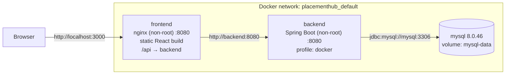

# Running PlacementHub with Docker

One command starts the whole application: MySQL, the Spring Boot backend and the React frontend. You don't need to install MySQL, Java or Node yourself.

## Prerequisites
- **Docker Desktop** (Windows/macOS), or Docker Engine with the Compose plugin (Linux).
- Docker Desktop must show **"Engine running"**.

## First-time setup (Windows, PowerShell, in the project folder)

```powershell
copy .env.example .env
notepad .env
```

Replace every `change-me…` value in `.env`:
- `MYSQL_PASSWORD`, `MYSQL_ROOT_PASSWORD`: any strong passwords.
- `APP_JWT_SECRET`: at least 32 random characters. The comment in the file has a PowerShell one-liner that generates one.
- `ADMIN_EMAIL` / `ADMIN_PASSWORD`: the admin account created on the first start (the password needs 12+ characters).
- `GEMINI_API_KEY`: optional. Without it, everything works except the AI guide, which replies "unavailable".

`.env` is git-ignored. Never commit it.

## Everyday commands

| What | Command |
|---|---|
| Build and start everything (in the background) | `docker compose up --build -d` |
| See status and health | `docker compose ps` |
| Follow all logs (Ctrl+C to stop watching) | `docker compose logs -f` |
| Logs of one service | `docker compose logs -f backend` |
| Stop (keeps your data) | `docker compose stop` |
| Start again after a stop | `docker compose start` |
| Restart only the backend | `docker compose restart backend` |
| Rebuild after changing code | `docker compose up --build -d` |
| Remove containers (keeps data) | `docker compose down` |
| **Delete everything including the database** | `docker compose down -v` ⚠️ |
| Open a MySQL shell | `docker compose exec mysql mysql -u placementhub -p placementhub` |
| Run the backend tests (outside Docker) | `cd backend; .\mvnw.cmd test` |

Once `docker compose ps` shows all three services as **healthy**:
- App: **http://localhost:3000**
- API docs (Swagger): **http://localhost:3000/swagger-ui.html**
- Health: **http://localhost:3000/actuator/health/readiness**
- MySQL Workbench: host `127.0.0.1`, port `3307`, user `placementhub`, password from `.env`

The first `up` takes a few minutes, because it downloads base images and Maven/npm packages. Later builds reuse cached layers and are much faster.

## How it fits together



| Concept | In this project |
|---|---|
| **Image** | A read-only template. `placementhub-backend:local` is built from `backend/Dockerfile`, `placementhub-frontend:local` from `frontend/Dockerfile`, and `mysql:8.0.46` is downloaded. |
| **Container** | A running instance of an image. `docker compose up` creates one per service. |
| **Network** | Compose creates a private network. Services find each other by **service name** (`mysql`, `backend`), which is why the backend connects to `jdbc:mysql://mysql:3306`, not `localhost`. |
| **Volume** | `mysql-data` stores MySQL's files outside the container, so data survives `down`/`up` and rebuilds. Only `down -v` deletes it. |
| **Ports** | Only the frontend (`3000→8080`) and MySQL (`127.0.0.1:3307→3306`, for Workbench) are published to your computer. The backend is reachable only inside the Docker network, through nginx. |
| **Environment variables** | All secrets and environment-specific settings come from `.env`, never from files baked into an image (both `.dockerignore` files exclude local secret files). |
| **Health checks** | MySQL: `mysqladmin ping`. Backend: `/actuator/health/readiness` (includes the database). Frontend: `/healthz`. `depends_on: condition: service_healthy` starts each service only when the one before it is truly ready, not just started. |

### Start-up and shutdown
1. **mysql** starts. On the very first run it creates the database and the `placementhub` user (this takes about 20–40 s).
2. When mysql is healthy, **backend** starts. Flyway applies migrations V1–V4 to the empty database, and `AdminBootstrap` creates the admin from `.env`.
3. When the backend reports **ready**, **frontend** (nginx) starts.
4. `docker compose stop` sends SIGTERM. Spring Boot finishes in-flight requests for up to 20 s (`server.shutdown: graceful`) before exiting.

### Image design
- **Multi-stage builds:** the JDK, Maven and Node exist only in the build stages. The backend runs on a JRE-only image; the frontend is static files served by nginx.
- **Non-root:** the backend runs as user `placementhub`, nginx as the unprivileged `nginx` user.
- **Layered jar:** dependencies, the Spring Boot loader and application classes are separate layers, so a code change rebuilds only the small top layer.
- **Pinned versions:** exact base-image tags (`eclipse-temurin:17.0.20_8`, `node:22.23.2`, `nginx-unprivileged:1.28.0`, `mysql:8.0.46`) and `npm ci` with the lockfile give reproducible builds.
- **No hard-coded API URL:** the React build calls `/api/...` on its own origin, and nginx forwards those calls to the backend. That removes CORS and keeps per-environment URLs out of the bundle. nginx also sends `index.html` for unknown paths, so page refreshes work.

## Troubleshooting
| Symptom | Fix |
|---|---|
| `Set MYSQL_PASSWORD in .env` (or similar) | Create `.env` from `.env.example` and fill it in. |
| `port is already allocated` | Change `FRONTEND_PORT` or `MYSQL_HOST_PORT` in `.env`. |
| Backend keeps restarting | `docker compose logs backend`. Usually a wrong password, or a JWT secret shorter than 32 characters. |
| Changed MySQL passwords in `.env` and now the backend can't connect | MySQL only reads them on the first start. Either change them back, or delete the data with `docker compose down -v`. |
| Admin password doesn't work | The admin is created only if that email doesn't exist yet; changing `ADMIN_PASSWORD` later has no effect. |

## Docker Compose is for local development
This setup is for running the full stack on one machine. Production (Azure) runs the backend on App Service and the frontend on Static Web Apps, with managed MySQL, backups and TLS. See the deployment section of the README. Running Compose on a single server is not a production orchestration setup: there's no failover, no rolling deploys and no managed secrets.
