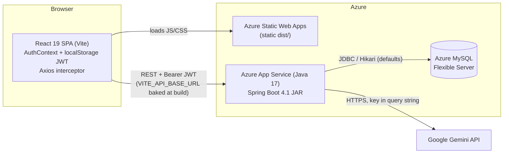
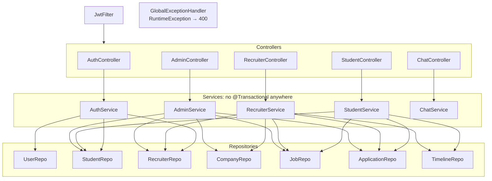
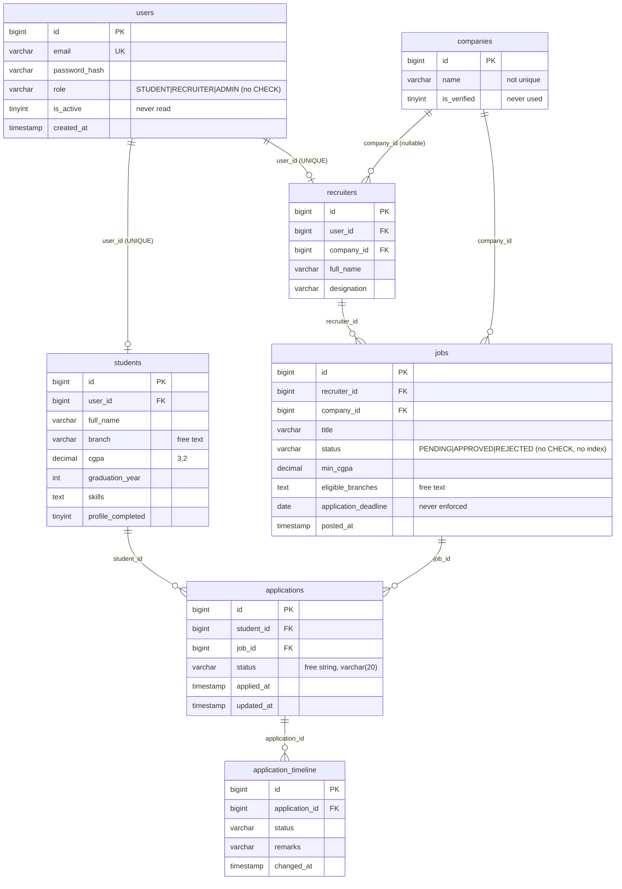
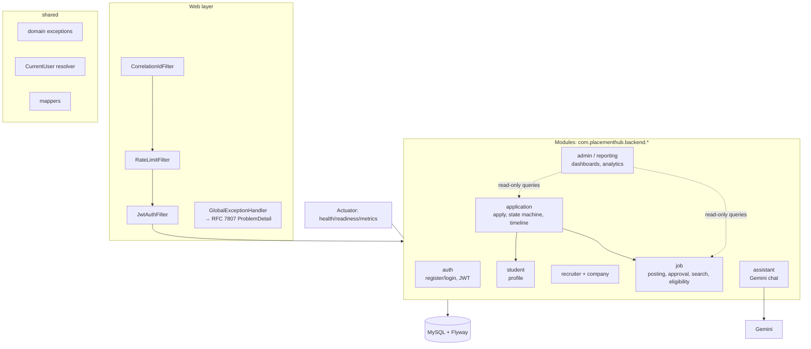
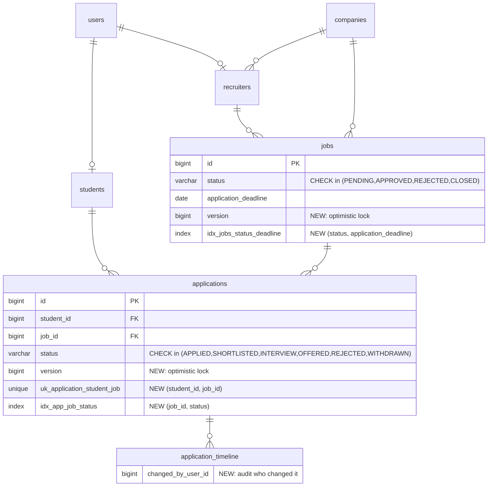
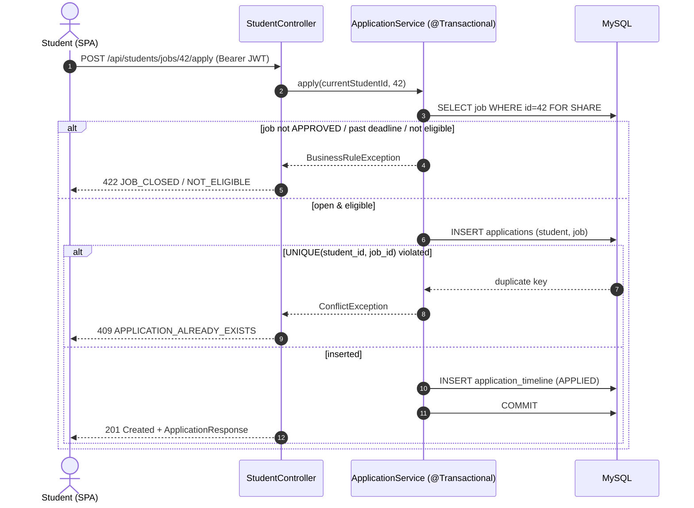
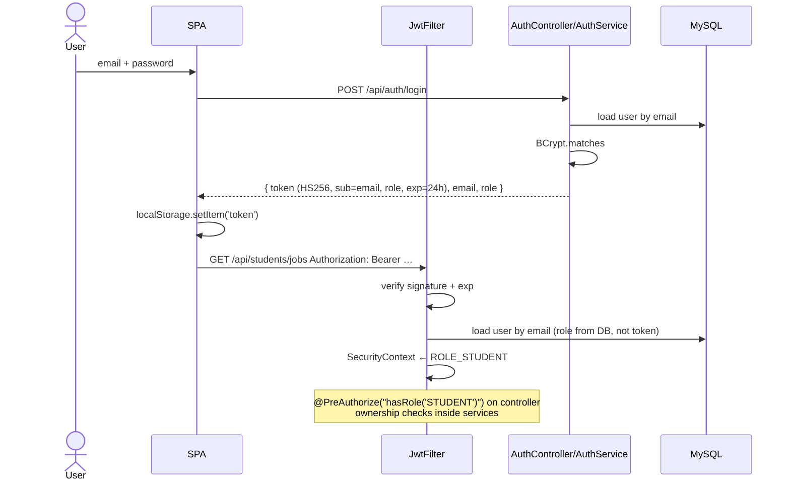
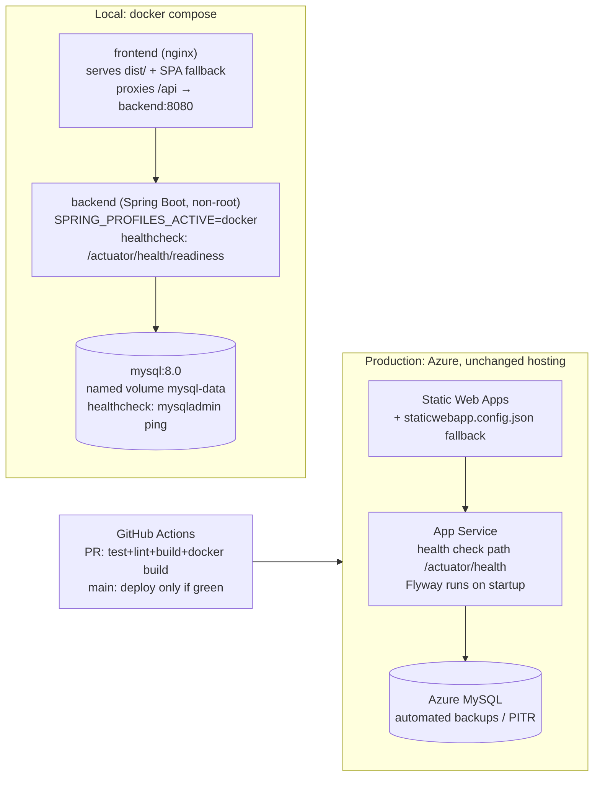

# PlacementHub — Milestone 1: Repository Audit & System Design Proposal

_Audit date: 2026-10-21 · Commit audited: `6d8f734` (`main`) plus 3 uncommitted files_

Everything in this document was checked against the source code, the local MySQL schema (`mysqldump --no-data`), and real command output. Where something could not be verified, it says so.

---

## 0. Executive summary

PlacementHub is a working three-role (Student / Recruiter / Admin) placement portal. It has a sensible layered Spring Boot backend, a React SPA, and a live Azure deployment. The foundation is reasonable, but it has **one critical security hole**, **no database-level protection for its core business rule** (one application per student per job), **no transactions**, **no schema migrations in the repo**, and **effectively no tests**.

**Top 5 issues, in priority order**

| # | Severity | Issue | Evidence |
|---|---|---|---|
| 1 | 🔴 Critical | **Anyone can register as ADMIN.** `RegisterRequest.role` accepts any `Role`, including `ADMIN`. `AuthService.register` saves it and returns an ADMIN JWT. | `dto/RegisterRequest.java`, `service/AuthService.java:31-48` |
| 2 | 🔴 High | **Duplicate applications are possible.** The service checks `existsByStudentIdAndJobId` and then inserts, with no transaction and no `UNIQUE(student_id, job_id)` in the DB. Two concurrent clicks can create two rows. | `StudentService.applyToJob`, `applications` DDL |
| 3 | 🔴 High | **Business rules are not enforced on the server.** The deadline is never checked. CGPA and branch eligibility are only used for "Recommended" and not when applying. Application status accepts any string, and any transition is allowed. A recruiter can edit an *approved* job and it stays approved. | `StudentService`, `RecruiterService.updateJob/updateApplicationStatus`, `AdminService.updateJobApproval` |
| 4 | 🟠 High | **Error handling returns the wrong HTTP status codes.** Every `RuntimeException` becomes `400`. That includes "not found", "no access", Spring's own `AccessDeniedException` (so a role violation returns 400, not 403), and DB errors, whose raw SQL message reaches the client. JWT parse/expiry exceptions are thrown inside the filter, outside `@RestControllerAdvice`. | `GlobalExceptionHandler`, `JwtFilter` |
| 5 | 🟠 High | **The schema exists only in live databases.** `ddl-auto=validate` and no DDL/migration files are committed. The README says "run the schema", but that schema is not in the repo. A fresh environment (Docker, CI, a new developer) cannot be created. | repo tree, `application.properties` |

**Also important right now:** the 3 uncommitted files change `/api/admin/students|recruiters|jobs` to return a `Page`. The frontend still does `setStudents(res.data)` and then `.map()`, so **the uncommitted change breaks the three admin list pages**.

---

## 1. Actual stack (verified)

| Layer | Expected | **Actual** |
|---|---|---|
| Language | Java | Java 17 (`pom.xml`). Local JDK is 17.0.20 |
| Framework | Spring Boot | **Spring Boot 4.1.0** (Hibernate ORM 7.4.1, Spring Security 7) |
| Auth | JWT + BCrypt | jjwt **0.11.5** (old API, `parserBuilder`), `BCryptPasswordEncoder` (default strength 10) |
| Persistence | JPA / MySQL | Spring Data JPA, MySQL Connector/J. Local MySQL **8.0.46**. Azure Database for MySQL Flexible Server (per README) |
| Validation | Bean Validation | Present, but only applied to auth, job create/update, and status DTOs |
| Migrations | Flyway | **None.** `ddl-auto=validate`; DDL not in repo |
| API docs | OpenAPI | **None** (Swagger paths are `permitAll` but springdoc is not a dependency) |
| Observability | Actuator | **None** (only `GET /` returns a string) |
| Frontend | React/Vite/Tailwind/Axios/Recharts | React 19.2, Vite 8, Tailwind 4, Axios 1.19, Recharts 3, React Router 7, lucide-react |
| Frontend tests | — | **None** (no Vitest/Jest) |
| Docker | Dockerfiles + Compose | **None.** Docker is also **not installed** on this machine |
| CI/CD | GitHub Actions | 2 Azure-generated deploy workflows. Backend uses `-DskipTests`. No lint/test gate |
| Extra | — | Gemini chatbot (`/api/chat`) via `RestTemplate` |
| Redis | optional | Not present (correct for current scale) |

### Verified command results

| Command | Result |
|---|---|
| `./mvnw test` | ✅ **1 test, 0 failures** (`contextLoads`). It only passes because it connects to the **local MySQL** using the git-ignored `application.properties`. It would fail in CI, which is why CI skips tests. |
| `npm run lint` | ❌ **6 errors, 2 warnings**, mostly `react-hooks/set-state-in-effect` (e.g. `BrowseJobs.jsx:20`, `MyJobs.jsx:21`) |
| `docker --version` | ❌ not installed |

### Repository hygiene
- **`backend/venv/` (845 files of a Python virtualenv) is committed to git.** It is unrelated to the Java app and should be untracked (`git rm -r --cached backend/venv` + `.gitignore`).
- `frontend/.env` and `application.properties` are correctly git-ignored. **No secrets were found in tracked files.**
- No `.env.example` / `application-example.properties` exists. The README contains the template instead.

---

## 2. Current architecture

### Backend structure (as-is)

**What's good:** a clean Controller → Service → Repository split, DTOs at the API boundary (no entities are returned directly), ownership checks for recruiter jobs and student applications, stateless sessions, server-side Gemini key, and CORS with an allow-list.

**What's weak:** `mapToJobResponse` is copy-pasted 3× and `mapToApplicationResponse` 2×. "Current user" lookup is a static `SecurityContextHolder` helper. Statuses are magic strings scattered across 4 classes. There are no domain exceptions.

---

## 3. Current entity-relationship diagram (from live local schema)

**Schema findings**
- ❌ **No `UNIQUE (student_id, job_id)` on `applications`.** This is the core invariant.
- ❌ No index on `jobs.status` or `applications.status`. Both are used in `findByStatus` / `countByStatus` on every listing and dashboard call.
- ❌ No version columns, so optimistic locking is impossible.
- ❌ FKs have no `ON DELETE` rule. `RecruiterService.deleteJob` on a job that has applications will hit a FK violation. That violation then surfaces as a `400` containing the raw SQL message (via the catch-all handler).
- ⚠️ Status/role columns have no `CHECK` constraint, and Java uses `String` rather than enums.
- ⚠️ `cgpa decimal(3,2)` allows a maximum of 9.99. That's fine for a 10-point scale, but the API doesn't validate the range.
- ⚠️ `eligible_branches` is comma-ish free text, matched with `contains()`, so "IT" matches "CIVIL ENGINEERING WITH IT". This is a known limitation in the README.
- ⚠️ Mixed `timestamp` (DB default) and `LocalDateTime.now()` (JVM default zone), so the time-zone semantics are unclear.

---

## 4. Current API inventory (26 endpoints)

| # | Method | Path | Auth | Request | Response | Notes |
|---|---|---|---|---|---|---|
| 1 | GET | `/` | **authenticated** | – | text | "Health" endpoint, but not public; Azure probes get 401/403 |
| 2 | POST | `/api/auth/register` | public | `RegisterRequest` ✔ valid | `AuthResponse` | 🔴 accepts `role: ADMIN`; returns 200 not 201 |
| 3 | POST | `/api/auth/login` | public | `LoginRequest` ✔ | `AuthResponse` | no rate limit; `is_active` ignored |
| 4 | GET | `/api/students/profile` | STUDENT | – | `StudentProfileResponse` | |
| 5 | PUT | `/api/students/profile` | STUDENT | `StudentProfileUpdateRequest` ✘ no validation | profile | null fields overwrite data; any CGPA accepted |
| 6 | GET | `/api/students/jobs` | STUDENT | – | `List<JobResponse>` | unpaginated; includes past-deadline jobs |
| 7 | GET | `/api/students/jobs/recommended` | STUDENT | – | `List<JobResponse>` | in-memory filter over all approved jobs |
| 8 | POST | `/api/students/jobs/{jobId}/apply` | STUDENT | – | `ApplicationResponse` | 🔴 race, no deadline/eligibility check, 200 not 201 |
| 9 | GET | `/api/students/applications` | STUDENT | – | `List<ApplicationResponse>` | N+1 (timeline query per app) |
| 10 | GET | `/api/students/applications/{id}` | STUDENT | – | `ApplicationResponse` | ownership ✔, but "not yours" = 400 |
| 11 | GET | `/api/recruiter/profile` | RECRUITER | – | `RecruiterProfileResponse` | |
| 12 | PUT | `/api/recruiter/profile` | RECRUITER | ✘ no `@Valid` | profile | creates/edits company inline |
| 13 | POST | `/api/recruiter/jobs` | RECRUITER | `JobRequest` (title only validated) | `JobResponse` | salaryMin > salaryMax and past deadlines accepted |
| 14 | GET | `/api/recruiter/jobs` | RECRUITER | – | `List<JobResponse>` | |
| 15 | PUT | `/api/recruiter/jobs/{id}` | RECRUITER (owner ✔) | `JobRequest` | `JobResponse` | 🟠 approved job stays APPROVED after edit |
| 16 | DELETE | `/api/recruiter/jobs/{id}` | RECRUITER (owner ✔) | – | 204 | FK failure if applications exist |
| 17 | GET | `/api/recruiter/jobs/{jobId}/applications` | RECRUITER (owner ✔) | – | `List<ApplicationResponse>` | ⚠️ **no student info returned** (UI shows only "Application #id") |
| 18 | PUT | `/api/recruiter/applications/{id}/status` | RECRUITER (owner ✔) | `{status, remarks}` | `ApplicationResponse` | 🔴 any string, any transition, lost updates; `updated_at` not set by JPA |
| 19 | GET | `/api/admin/dashboard` | ADMIN | – | counts | 6 count queries |
| 20 | GET | `/api/admin/students` | ADMIN | `page,size` *(uncommitted)* | `Page` | ⚠️ breaks current frontend |
| 21 | GET | `/api/admin/recruiters` | ADMIN | `page,size` *(uncommitted)* | `Page` | ⚠️ breaks current frontend |
| 22 | GET | `/api/admin/jobs` | ADMIN | `page,size` *(uncommitted)* | `Page` | ⚠️ breaks current frontend; no max `size` |
| 23 | GET | `/api/admin/jobs/pending` | ADMIN | – | `List<JobResponse>` | |
| 24 | PUT | `/api/admin/jobs/{jobId}/approve` | ADMIN | `{status}` | `JobResponse` | any string accepted (e.g. `"FOO"`) |
| 25 | GET | `/api/admin/analytics` | ADMIN | – | `AnalyticsResponse` | 5 + 3 count queries |
| 26 | POST | `/api/chat` | any authenticated | `ChatRequest` ✘ no validation | `ChatResponse` | unbounded history → unbounded Gemini cost; upstream error body leaked |

**Frontend gaps found while mapping the API**
- `JobDetails.jsx` downloads **all** approved jobs and `.find()`s one, because there's no `GET /jobs/{id}`.
- `App.jsx` declares `/recruiter/profile` **twice** (the second, pointing to `CompanyProfile`, is dead). There is no 404 route.
- There's no `staticwebapp.config.json`, so refreshing a deep link (e.g. `/student/jobs`) on Azure SWA likely 404s. _(Not verified against the live site.)_
- The 401 interceptor does a hard redirect. Role-mismatch routes redirect to `/login` rather than to the user's dashboard.

---

## 5. Code quality & security audit

### 5.1 Security

| Sev | Finding | Fix (milestone) |
|---|---|---|
| 🔴 | Self-registration as `ADMIN` (privilege escalation) | Reject `ADMIN` in register; separate `RegisterRole` enum; seed admin via migration/CLI (M2) |
| 🟠 | `AccessDeniedException` caught by `RuntimeException` handler → **400** instead of 403 | Domain exceptions + `ProblemDetail`; let Spring Security exceptions through (M2) |
| 🟠 | Expired/malformed JWT throws inside `JwtFilter`, so the client doesn't get a clean 401. The frontend logout-on-401 logic may never fire. _(Exact status to be pinned by a test in M2.)_ | Catch `JwtException` in filter → `AuthenticationEntryPoint` → 401 JSON (M2) |
| 🟠 | Raw exception messages returned to clients (SQL errors, Gemini error body) | Generic message + correlation id; details only in logs (M2/M7) |
| 🟠 | `users.is_active` never checked → deactivated users can still log in / use tokens | Map to `UserDetails.isEnabled()` (M2) |
| 🟠 | Recruiter edits approved job → stays APPROVED (moderation bypass) | Edit of APPROVED job → back to PENDING, or lock fields (M2/M4) |
| 🟠 | No rate limiting on `/login`, `/register`, `/chat` (brute force / AI-cost abuse) | Bucket4j in-memory limiter per IP/user (M5) |
| 🟡 | JWT: 24 h lifetime, no revocation, HS256 secret length not validated at startup; jjwt 0.11.5 is outdated | Startup check ≥ 256-bit secret; upgrade jjwt 0.12; shorter TTL (M2) |
| 🟡 | Token in `localStorage` (XSS-readable) | Documented trade-off (see §9.4); keep for now |
| 🟡 | Gemini key in URL query string (ends up in proxy/access logs) | Send as `x-goog-api-key` header (M2) |
| 🟡 | `System.err.println` logging; `show-sql=true` in all envs | SLF4J, profile-specific config (M3/M7) |
| 🟡 | `allowCredentials(true)` without cookies; CORS origins hardcoded in Java | Externalise to config; drop credentials (M2) |
| ✅ | BCrypt hashing, stateless sessions, ownership checks on jobs/applications, secrets via env vars, no secrets in git | — |

### 5.2 Data access & performance

| Finding | Where | Impact |
|---|---|---|
| **No `@Transactional` anywhere** | all services | `register` can leave a `users` row without `students`. `applyToJob` can leave an application without a timeline entry. Status update and timeline insert aren't atomic. |
| **Check-then-act race on apply** | `StudentService.applyToJob` | duplicate rows under concurrency |
| **N+1: timeline per application** | `mapToApplicationResponse` | 1 + N queries for "My Applications" / applicants |
| **EAGER `@ManyToOne` everywhere** (JPA default) | all entities | each `Job` loads Recruiter → User and Company. With derived queries, Hibernate issues secondary selects per distinct parent. |
| `spring.jpa.open-in-view` enabled (default; warning in startup log) | config | DB connection held for whole request; hides lazy-loading bugs |
| Unpaginated job list + in-memory "recommended" filter | `StudentService` | O(all approved jobs) per request; fine at 100 jobs, wasteful at 10k |
| Missing indexes on `status` columns | schema | full scans for dashboards and listings |
| Lombok `@Data` on entities | entities | `equals/hashCode/toString` over associations. A risk once bidirectional relations are added. |

### 5.3 Testing / CI / deployment
- 1 test (`contextLoads`), which requires a live local DB. **0 unit, 0 integration, 0 security, 0 frontend tests.**
- The backend deploys to Production on every push to `main` **without running tests**. The frontend deploys with no lint gate, and lint is currently failing.
- No health endpoint suitable for Azure health checks. No Actuator.
- No Docker, Compose, or `.env.example`. A new developer must install MySQL and reconstruct the schema by hand.

---

## 6. Proposed architecture

### 6.1 Traffic assumptions (stated, not measured)

For one university, or a small group of colleges:

| Quantity | Assumption |
|---|---|
| Students | 5,000–20,000 registered |
| Recruiters / companies | 100–300 / 50–150 per season |
| Active jobs | 50–500 per season |
| Normal load | < 5 req/s |
| **Peak**: popular job opens, deadline closing | ~2,000 students hit apply/list within ~10 minutes, with bursts of maybe **50–150 req/s** for a few seconds |
| Data size | < 1 M application rows over years, which is small for MySQL |

**What this implies:** one MySQL primary and 1–2 stateless backend instances are enough. The real risk is **correctness under bursts** (duplicates, deadline races, lost status updates), not throughput. That is why the plan prioritises constraints, transactions and locking over caching or distributed systems. These numbers will be checked against a k6 baseline in M7.

### 6.2 Target: modular monolith

Keep one deployable Spring Boot app, but organise it by **business module**, each with its own controller/service/repository/DTO packages. Cross-module calls go through services, never through another module's repository.

**Why each layer exists**
- **Controller:** HTTP only. It maps URL/body to DTOs, applies `@Valid` and `@PreAuthorize`, and picks status codes. No business `if`s.
- **Service:** owns use cases and **transaction boundaries** (`@Transactional` at the service method). This is where invariants live: eligibility, deadlines, state transitions, ownership.
- **Repository:** data access only. Uses fetch-joined/projection queries so services don't trigger lazy loads.
- **DTO / mapper:** a stable API contract that is independent of entity shape. This avoids leaking `passwordHash`, lazy proxies, and recursion.
- **Domain exceptions** (`NotFoundException`, `ConflictException`, `ForbiddenException`, `BusinessRuleException`): services express *what* went wrong, and the advice maps them to 404/409/403/422.

**Why not microservices:** one team, one database, and strongly consistent cross-entity rules (apply = read job + read student + insert application atomically). Splitting would turn a local ACID transaction into a distributed saga for no benefit at this scale. The module boundaries keep a future extraction possible (e.g. `assistant` or `notification` first).

### 6.3 Key design decisions & trade-offs

| Area | Decision | Trade-off |
|---|---|---|
| API versioning | Keep `/api/**` paths (no breaking rename). Document `/api/v1` as an alias added only when a breaking change is needed. | Avoids churn now. Versioning is a policy, not a prefix. |
| Errors | `ProblemDetail` (RFC 7807) with `code`, `detail`, `traceId`, `fieldErrors` | The frontend must read `detail` instead of `error`. Both will be sent during transition. |
| Pagination | `?page&size&sort` with max `size=100`, returned as a stable DTO (`content,page,size,totalElements,totalPages`), not raw `PageImpl` | Stable JSON across Spring versions |
| Filtering/search | Job list filters: `q` (title/company LIKE), `jobType`, `location`, `eligibleOnly`, `openOnly`, via a Specification or JPQL | Avoids a search engine. Full-text index later if needed. |
| Caching | **No Redis now.** At most a Caffeine (in-process) 30–60 s cache for admin analytics | Redis adds infra that the assumed load does not need (see §8) |
| Rate limiting | Bucket4j in-memory on `/auth/login`, `/auth/register`, `/chat` | Per-instance limits. Redis-backed buckets are needed only once there is more than 1 instance. |
| Background jobs | None required now. `@Scheduled` job to auto-close jobs past deadline (idempotent `UPDATE … WHERE deadline < now AND status='APPROVED'`) | With >1 instance it needs ShedLock, or simply tolerate the idempotent double-run |
| Connection pool | Hikari explicit: `maximum-pool-size=10`, `connection-timeout=3s`, `open-in-view=false` | Small pool + short transactions beats a big pool |
| Scaling | Stateless JWT → N instances behind a load balancer. MySQL vertical scaling, then a read replica for analytics. | Writes stay on one primary, which is fine for this workload |
| Failure handling | Gemini: timeouts (connect 2 s, read 10 s) and a friendly fallback. DB down → readiness DOWN → LB stops routing. | Chat degrades gracefully. Core flows never depend on Gemini. |

### 6.4 Proposed ER changes (to be done in M3, via Flyway, nothing destructive without approval)

Deliberately **not** added yet: `roles/permissions` tables (3 fixed roles → enum is enough), `notifications` (no delivery channel exists), `interview_slots` (no requirement yet — see §7 C), separate `eligibility_criteria` table (a normalized `job_eligible_branches` table is proposed only if you want the branch-matching limitation fixed).

---

## 7. Concurrency & consistency design

| Scenario | Exists today? | Chosen strategy | Why this one |
|---|---|---|---|
| **A. Duplicate applications** | ✅ real bug | `UNIQUE(student_id, job_id)` + keep the `exists` pre-check (fast path) + catch `DataIntegrityViolationException` → **409 Conflict** `APPLICATION_ALREADY_EXISTS`. Insert application + first timeline row in one `@Transactional`. | Only the DB can enforce uniqueness across concurrent transactions and multiple app instances. Locks would serialize all applies for a job; a constraint only rejects actual duplicates. |
| **B. Deadline / job closing** | ✅ deadline not enforced at all | In the apply transaction: `SELECT … FROM jobs WHERE id=? FOR SHARE` (JPA `PESSIMISTIC_READ`), then validate `status=APPROVED`, deadline, and eligibility, then insert. Closing or editing a job takes the row's write lock, so it waits for in-flight applies, and later applies see the new state. **Rule: an application is accepted iff the job is open at the moment the apply transaction reads the job under the shared lock (server clock, `Asia/Kolkata`; deadline = end of that date).** | Shared locks let many students apply concurrently and only block against a status/deadline change. That change is rare, so contention is negligible. Optimistic `@Version` on the job would make every apply conflict with every other apply if applies touched the job row, which they don't. |
| **C. Interview slots** | ❌ no such feature | **Not building unless you want it.** If added: `UPDATE slots SET booked = booked + 1 WHERE id=? AND booked < capacity` (atomic conditional update; 0 rows → 409) + `UNIQUE(slot_id, application_id)`. | Simplest correct strategy, with no lock held across app code |
| **D. Concurrent status changes** | ✅ real (lost update, invalid transitions) | `ApplicationStatus` enum with an explicit transition table (e.g. `APPLIED→SHORTLISTED/REJECTED`, `OFFERED` and `REJECTED` terminal) + `@Version` on `Application`. The client sends the `version` it saw. A stale version → **409**, and the UI refetches. | Optimistic locking suits rare conflicts with human think-time between read and write. Pessimistic locks can't span two HTTP requests anyway. |

**Concepts to explain in interviews** (each will be demonstrated by a test in M4):
- **Concurrent HTTP requests:** separate threads, each with its own DB connection and transaction. Nothing serializes them unless the DB does.
- **Isolation (MySQL InnoDB default REPEATABLE READ):** a plain `SELECT` reads a snapshot. It does *not* prevent another transaction inserting the same `(student, job)`. That's why `exists`-then-`insert` is racy even inside a transaction.
- **Optimistic locking:** no lock. `UPDATE … WHERE id=? AND version=?`. 0 rows → conflict. Cheap, but the caller must retry or report.
- **Pessimistic locking:** `SELECT … FOR UPDATE/FOR SHARE` holds row locks until commit. Correct, but it reduces concurrency and risks deadlocks if used carelessly.
- **Idempotency:** repeating a request has the same effect. Apply becomes effectively idempotent via the unique key (a retry → 409 with the existing application id). An `Idempotency-Key` header is unnecessary here.
- **Distributed locks (Redis/ZooKeeper):** for coordinating things the DB can't see. Not needed: every invariant here lives in one MySQL database.

**Testing approach:** Testcontainers MySQL 8.0 (matching prod major version). Fire N threads through a `CountDownLatch` start gate at the real service/HTTP layer, then assert exactly 1 row / exactly 1 success / N-1 × 409. **Requires Docker Desktop.** The fallback is a dedicated local MySQL test database.

### Student application sequence (target)

---

## 8. Redis evaluation

| Use case | Needed now? | Reasoning |
|---|---|---|
| Job listing cache | No | < 500 jobs. An indexed, paginated query is a few ms. Invalidation on approve/edit/close adds bugs for no measurable gain. |
| Dashboard/analytics cache | Not Redis | Admin-only, low QPS. If needed, Caffeine with a 60 s TTL; stale counts are acceptable. |
| Rate limiting | Not yet | In-memory Bucket4j is fine for 1 instance. **This becomes the first real reason for Redis once there are ≥2 instances.** |
| Uniqueness / locks | **Never** | Invariants belong in MySQL. Redis is not the source of truth. |
| Background queue | No | No async work exists (no email/notifications yet) |

**Decision:** document it, don't add it. Revisit when k6 numbers or multi-instance deployment justify it.

---

## 9. Authentication & authorization

### 9.1 Current flow

### 9.2 Authorization matrix (target)

| Resource | Student | Recruiter | Admin |
|---|---|---|---|
| Own profile | RW | RW | R |
| Other students' profiles | ✘ | Only applicants to **their** jobs (R, limited fields) | R |
| Jobs | R (approved, open) | CRUD own; edit of approved → re-review | approve/reject/close any |
| Applications | create/read **own** | read/update status for **own jobs** | read all |
| Analytics | ✘ | own jobs only (future) | all |

### 9.3 Planned improvements (M2)
- Block admin self-registration.
- Check `is_active`.
- Return proper 401/403 JSON.
- Validate the JWT secret length at startup.
- Upgrade jjwt to 0.12.x.
- Add security headers (default Spring headers + CSP on the frontend server).
- Externalise CORS.
- Add rate limits (M5).

**Refresh tokens / logout:** not added now. The current UX has no "remember me" requirement. Logout is client-side. Lowering the token TTL from 24 h to ~2–8 h is the cheap mitigation. A server-side `token_version` column on `users` can be added to support "log out everywhere" and immediate deactivation without a token blacklist.

### 9.4 localStorage vs cookies (trade-off)
- **localStorage (current):** simple, and works cross-origin (SWA ↔ App Service on different domains). However, any XSS can steal the token. Mitigations: React's default escaping, no `dangerouslySetInnerHTML`, a strict CSP, and short TTL.
- **HttpOnly Secure SameSite cookie:** JS can't read it, but you then need **CSRF protection**, and cross-site deployments need `SameSite=None` plus correct CORS credentials. That's simplest when frontend and API share an origin (which the Docker/nginx setup in M6 will provide).
- **Recommendation:** keep localStorage now. Revisit after M6, once same-origin serving exists.

---

## 10. Deployment architecture (target)

Using a same-origin `/api` proxy in nginx means the Docker build needs **no** baked-in API URL. Azure keeps `VITE_API_BASE_URL` (empty → same origin).

---

## 11. Prioritized improvement backlog

| P | Item | Effort | Milestone |
|---|---|---|---|
| P0 | Block ADMIN self-registration | S | M2 |
| P0 | Resolve uncommitted admin pagination (finish frontend side or revert) | S | M2 |
| P0 | Correct status codes / ProblemDetail / JWT 401 / AccessDenied 403 | M | M2 |
| P0 | Flyway baseline from current schema | M | M3 |
| P0 | `UNIQUE(student_id, job_id)` + 409 handling + `@Transactional` | M | M3/M4 |
| P1 | Enforce deadline + eligibility on apply | M | M4 |
| P1 | Status enums, state machine, `@Version` | M | M4 |
| P1 | Recruiter sees applicant details (name, branch, CGPA, resume) | S | M4 |
| P1 | Fix N+1 (fetch joins/projections), LAZY, `open-in-view=false`, indexes | M | M3 |
| P1 | Real test suite (unit + slice + Testcontainers) and CI gate | L | M4/M8 |
| P1 | Docker + Compose + Actuator health | M | M6 |
| P2 | Pagination/filter/search for student jobs, `GET /jobs/{id}` | M | M5 |
| P2 | OpenAPI (springdoc), rate limiting | S | M5 |
| P2 | De-duplicate mappers, module packages | M | M3 |
| P2 | Logging/correlation IDs/metrics, k6 baseline | M | M7 |
| P3 | Frontend lint fixes, tests (Vitest + RTL), 404 route, SWA fallback config | M | M9 |
| P3 | Remove `backend/venv` from git | XS | M2 |

---

## 12. Implementation roadmap

Each milestone ends runnable, tested, and with the frontend still working.

| Milestone | Scope | Exit criteria |
|---|---|---|
| **M1 ✅** | This audit | Approved plan |
| **M2: Security & correctness hotfixes** | Admin self-registration fix; domain exceptions + ProblemDetail (keep `error` field for compatibility); JWT filter 401; `is_active`; recruiter edit → re-pending; Gemini header + timeouts + input limits; finish admin pagination in frontend; untrack `venv`. Add first `@WebMvcTest` + Spring Security tests. | Tests prove: ADMIN register → 400, wrong role → 403, expired token → 401 |
| **M3: Database foundation** | Flyway (`V1__baseline.sql` = today's schema, `baseline-on-migrate` for existing DBs); `V2`: unique key, indexes, version columns, CHECKs; `@Transactional` on all write use cases; LAZY + fetch joins; `open-in-view=false`; shared mappers; enums for statuses. | Fresh DB builds from migrations; existing DB migrates without data loss; query count per endpoint asserted in tests |
| **M4: Application workflow & concurrency** | Apply with lock + deadline + eligibility; state machine + optimistic locking; applicant details for recruiters; Testcontainers concurrency tests for A, B, D. | 50 parallel duplicate applies → exactly 1 row; stale status update → 409 |
| **M5: API polish** | Paginated/filterable job search, `GET /api/students/jobs/{id}`, 201 on create, springdoc OpenAPI with examples, Bucket4j rate limits, Axios error handling updated. | Swagger UI documents all endpoints; frontend uses new endpoints |
| **M6: Docker** | Backend multi-stage Dockerfile (non-root, layered jar), frontend nginx Dockerfile, `compose.yaml` with MySQL healthcheck, named volume, `.env.example`, Actuator liveness/readiness, Windows commands. | `docker compose up --build` → working app from zero |
| **M7: Observability & load test** | JSON logs, correlation ID (MDC + response header), Micrometer metrics (latency, errors, Hikari), slow query log; k6 scripts; **baseline numbers recorded before tuning**. | Measured RPS / p50/p95/p99 published in docs |
| **M8: CI/CD** | PR workflow: backend tests (Testcontainers), frontend lint+test+build, Docker builds, optional Trivy/dependency scan; deploy workflows gated on it. | Red tests block deploy |
| **M9: Frontend quality** | Lint errors fixed, Vitest + RTL tests for login, apply (incl. 409), role routing; 404 route; SWA fallback config; optional Playwright E2E. | Lint clean; tests green |
| **M10: Docs & interview prep** | README rewrite, architecture docs, 2-min and 5-min walkthroughs, Q&A grounded in code. | — |

### Decisions needed from you

1. **Uncommitted pagination change:** keep it and update the 3 admin pages in M2 (recommended), or revert it?
2. **Untrack `backend/venv/`:** OK to `git rm -r --cached` it? This is non-destructive locally.
3. **Production data before M3:** the unique constraint will fail if prod already has duplicate `(student_id, job_id)` rows. You'll need to run a provided read-only `SELECT … GROUP BY … HAVING COUNT(*)>1` on Azure, and decide how duplicates get merged if any exist.
4. **Docker Desktop:** needs to be installed before M4 (Testcontainers) and M6.
5. **Interview slots (Scenario C):** build it as a new module, or leave it documented only?

---

## 13. Status tracker

**Completed**

M1: audit (this document).

M2: security and correctness hotfixes (2026-10-21):
- **Registration:** ADMIN self-registration is blocked, both in DTO validation and in `AuthService`.
- **Typed errors:** added `NotFound`, `Forbidden`, `Conflict`, `BusinessRule` and `ServiceUnavailable` exceptions, with one `ErrorResponse` JSON shape (`error`, `status`, `code`, `path`, `timestamp`, `fieldErrors`).
- **Correct status codes:**
  - 401 for missing, expired, invalid or forged tokens and for deactivated accounts;
  - 403 for a wrong role (previously 400);
  - 404 for missing or not-owned resources;
  - 409 for duplicates and dependent rows;
  - 500 without leaking internals.
- **JWT handling:**
  - the filter no longer throws, so public endpoints still work with a stale token;
  - jjwt upgraded 0.11.5 → 0.12.6;
  - the secret length is checked at startup.
- **Deactivated accounts:** `users.is_active` is now enforced.
- **Validation:** request validation (sizes matching DB columns, CGPA 0–10, salary range, status allow-lists) on all write endpoints.
- **Recruiter rules:**
  - editing a job sends it back to PENDING;
  - a job that has applications can't be deleted (409 instead of a FK error);
  - saving a recruiter profile no longer creates a nameless company;
  - status updates now set `updated_at`.
- **Chat:**
  - Gemini key sent in a header;
  - 3 s connect / 20 s read timeouts;
  - history capped at 20 messages of up to 2000 characters;
  - upstream errors no longer reach the client.
- **CORS:** origins are configurable (`APP_CORS_ALLOWED_ORIGINS`), and the allowed headers and credentials are tightened.
- **Admin pagination:** the admin lists return `PageResponse` with `size` capped at 100. The frontend admin pages have Previous/Next controls.
- **Frontend error messages:** profile, job, delete and status forms now show server errors instead of failing silently.
- **Repo hygiene:** `backend/venv` is untracked.
- **Tests:** 30 new tests (`ApiSecurityTest` web-layer security tests, `Milestone2ServiceRulesTest` unit tests). Neither needs a database.

**Remaining:** M3–M10.

**Known limitations (current):**
- No transactions yet.
- The duplicate-application race is still open (M3/M4).
- Deadline and eligibility are not enforced (M4).
- There are no status transition rules (M4).
- N+1 queries remain (M3).
- No rate limiting (M5).
- 5 pre-existing frontend lint errors remain (M9).
- `BackendApplicationTests` still needs a local MySQL.
